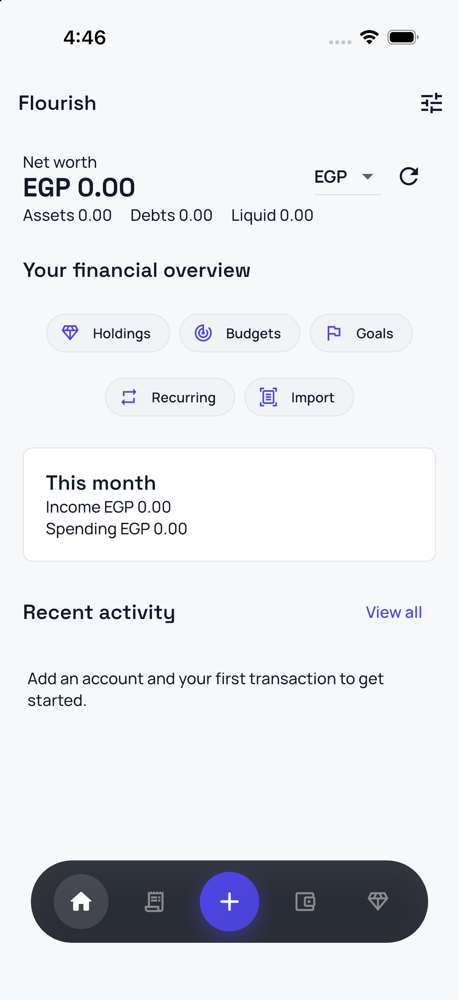
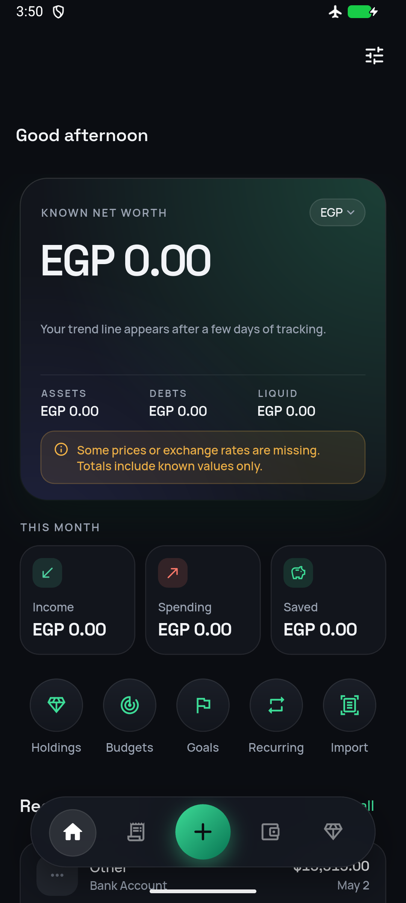

# Flourish

**Flourish** is a local-first personal finance app for Android and iOS. Track accounts, spending, budgets, goals, and recurring payments—and go further with a **Wealth** workspace for holdings, loans, multi-currency reporting, encrypted backups, and spreadsheet import.

Data stays on your device in SQLite. Optional market and FX feeds refresh quotes; nothing is sold to third-party aggregators.

<p align="center">
  
  
</p>

## Highlights

- **Home** — Known net worth, liquid balance, month income/spending/saved, recent activity
- **Ledger** — Transactions with calendar, filters, and swipe actions
- **Wealth** — Holdings, obligations, reports, tools (backup, import/export, FX overrides)
- **Accounts & budgets** — Multi-account balances, category budgets, savings goals
- **Detailed spending** — What paid (card, wallet, InstaPay, cash), merchant, original currency with foreign-transaction fees, refunds
- **Credit cards** — Limit, available credit, statement, minimum due, interest estimate, cash advances
- **Payment detection** — Bank SMS and bank/wallet alerts in English and Arabic become a review inbox (Android notification access; iOS Shortcuts)
- **Import** — Share bank SMS/notification text (Android intent / iOS share extension); review before save
- **Privacy** — On-device storage kept out of cloud backup; encrypted daily and exported backups; biometric app lock; optional AI only with your own key and consent ([privacy policy draft](docs/privacy-policy.md))

Built with **Flutter**, **Riverpod**, **Drift**, and **go_router**. Default reporting currency for new installs is **EGP** (changeable in settings).

## Documentation

| Doc | Description |
|-----|-------------|
| [Project overview](docs/OVERVIEW.md) | What the app is, main screens, principles |
| [Architecture](docs/ARCHITECTURE.md) | Code layout, navigation, data flow |
| [Getting started](docs/GETTING_STARTED.md) | Install Flutter, run, test, code generation |
| [Releases](docs/RELEASE.md) | Versioning, signing, GitHub Releases |
| [Platforms](docs/PLATFORMS.md) | Android vs iOS behavior and QA checklist |
| [Finance implementation](docs/FINANCE_IMPLEMENTATION.md) | Ledger rules, feeds, backup, verification |
| [Audit](docs/AUDIT.md) | Known bugs and logic gaps with fix status |
| [Changelog](CHANGELOG.md) | Version history |

Full index: [docs/README.md](docs/README.md).

## Quick start

```bash
git clone https://github.com/Basta97/Flourish.git
cd Flourish
flutter pub get
flutter run
```

## Quality checks

```bash
dart format --set-exit-if-changed .
flutter analyze
flutter test
```

Drift codegen after schema changes:

```bash
dart run build_runner build --delete-conflicting-outputs
```

## Installing a release

Official builds are published on [GitHub Releases](https://github.com/Basta97/Flourish/releases). Download the APK for your phone (`Flourish-<version>-arm64-v8a.apk` for almost every current phone, `armeabi-v7a` for older 32-bit ones), allow installation from your browser/files app if prompted, and open it on Android 7+ (API 24).

Before switching to the Google Play version, export an encrypted backup (Settings → Export encrypted backup); see [Moving GitHub users to Play](docs/RELEASE.md#moving-github-users-to-play).

iOS builds are distributed via TestFlight or the App Store when available (see [Releases](docs/RELEASE.md)).

## Contributing

1. Fork and branch from `main`.
2. Run format, analyze, and tests before opening a PR.
3. Update [CHANGELOG.md](CHANGELOG.md) for user-visible changes.

## License

Application code: see repository license. Bundled fonts are under [SIL Open Font License](assets/fonts/manrope/OFL.txt) in `assets/fonts/`.
