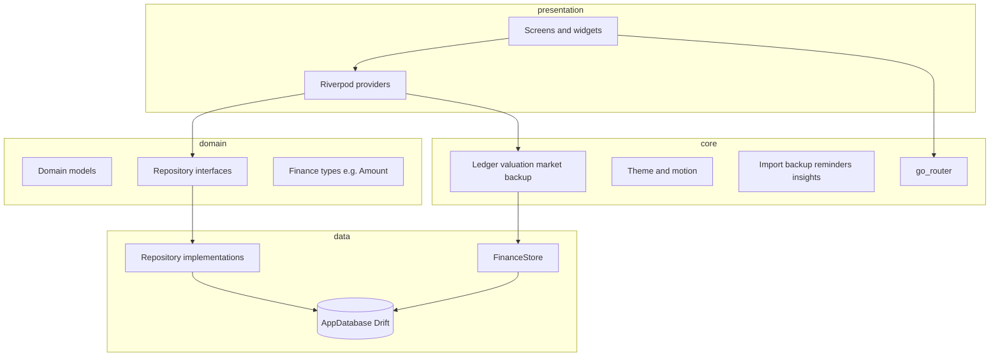

# Architecture

Flourish follows a **layered Flutter** structure: UI and Riverpod providers call domain/repositories and finance services; persistence is **Drift** on SQLite.

## High-level diagram



## Directory map

| Path | Role |
|------|------|
| `lib/main.dart` | App bootstrap, database open, recurring processing |
| `lib/app.dart` | `MaterialApp.router`, theme mode, app lock wrapper |
| `lib/core/router/` | Routes, shell with island nav, deep links |
| `lib/core/theme/` | Colors, typography, spacing, `AppTheme` |
| `lib/core/motion/` | Durations, springs, haptics |
| `lib/core/finance/` | Ledger, valuation, contracts, backup, spreadsheet import, market data |
| `lib/core/services/` | Preferences, shared import, notification parsing, insights |
| `lib/domain/` | Entities and repository contracts |
| `lib/data/database/` | Drift tables, migrations, generated `database.g.dart` |
| `lib/data/repositories/` | Repository implementations |
| `lib/data/finance/` | `FinanceStore` — persisted finance records |
| `lib/presentation/` | Feature screens and feature-specific providers |
| `lib/shared/widgets/` | Reusable UI (cards, sheets, charts, list tiles) |

## Navigation

`go_router` defines a **ShellRoute** with five tabs (see `lib/core/router/app_router.dart`):

- `/dashboard`, `/transactions`, `/wealth`, `/search`, `/accounts`, `/budgets`, `/tools`, `/templates`, `/exchange-rates`

Modal routes (settings, categories, recurring, goals, smart import, account detail) use the root navigator so they cover the tab shell.

Tab changes use a custom **fade + scale** transition. Pushed routes use **Cupertino** transitions on iOS/macOS and **fade-forward** on Android (`app_theme.dart`).

## State management

**flutter_riverpod** provides:

- Database and repository singletons (`databaseProvider`, repository providers)
- Async lists (accounts, transactions, categories)
- Finance-specific providers (`finance_providers.dart`, dashboard aggregates)
- Theme mode (`themeModeProvider`)

`FinanceRuntime` wraps the tree for finance-store lifecycle and related context.

## Data and migrations

`AppDatabase` (Drift) holds accounts, categories, transactions, budgets, goals, recurring rows, and extended finance schema (see `FINANCE_IMPLEMENTATION.md` for schema version and rules).

After schema changes:

```bash
dart run build_runner build --delete-conflicting-outputs
```

## Testing

| Layer | Location |
|-------|----------|
| Unit / widget | `test/` |
| Finance rules | `test/finance/` |
| Layout / nav | `test/widgets/` |
| End-to-end | `integration_test/finance_flow_test.dart` |

CI runs format, analyze, and `flutter test` (see `.github/workflows/flutter.yml`).

## Native integrations

| Platform | Integration |
|----------|-------------|
| Android | `MainActivity`, share `SEND` intents, ML Kit OCR, local notifications |
| iOS | Share extension, shortcuts, Vision OCR, entitlements |

Details: [Platforms](PLATFORMS.md).

### Indexed search and currency discovery

`lib/data/search/` owns SQLite-derived document/FTS tables and resumable backfill. Source-table triggers update indexes atomically, including raw SQL restore/import paths. Search normalizes Arabic/English query text and safely quotes FTS input; monetary filters use exact decimal ordering rather than conversion or REAL comparisons. Matched account/category IDs expand through relationship indexes. Ranked result IDs are paginated before loading display metadata, and stale UI requests cannot replace newer results.

`CurrencyCatalog` combines a bundled Frankfurter active catalog, persistent cache, and provider discovery. Searchable selectors retain existing historical codes. `MarketDataService.refreshPairs` bounds requests to selected/app-used/favorite pairs; `ValuationService.resolveRate` exposes effective or automatic-only observations to the converter. Search has no network dependency.
